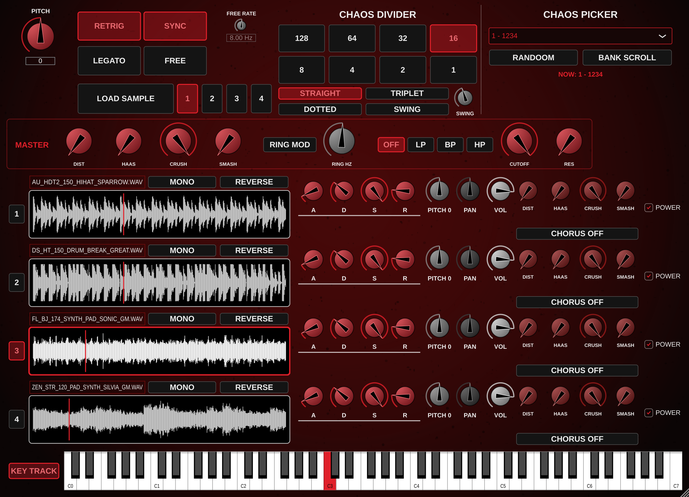

<div align="center">

# CHAOS TRIGGER
### by iNi

**A 4-lane loop step sequencer for chaotic beat mangling.**
VST3 · AU · Standalone. For Windows and macOS.

<br>

<a href="https://github.com/fredchicoine/ChaosTrigger-Public/releases/latest/download/ChaosTrigger-Windows-Setup.exe"></a>
&nbsp;&nbsp;
<a href="https://github.com/fredchicoine/ChaosTrigger-Public/releases/latest/download/ChaosTrigger-Mac.pkg"></a>

<sub>Windows 10/11 (64-bit) · macOS 11 or later, Apple Silicon and Intel · <a href="https://github.com/fredchicoine/ChaosTrigger-Public/releases">all versions</a></sub>

</div>

<p align="center"></p>

---

## Contents
1. [What is Chaos Trigger?](#what-is-chaos-trigger)
2. [How it works](#how-it-works)
3. [Installing](#installing)
4. [Quick start: your first chaos in 60 seconds](#quick-start)
5. [The panel, control by control](#the-panel)
6. [Lane effects](#lane-effects)
7. [Master section](#master-section)
8. [Playing without MIDI](#playing-without-midi) · [KEY TRACK](#playing-notes-like-a-sampler-key-track)
9. [Multi-output routing (separate lanes to separate tracks)](#multi-output-routing)
10. [Automation](#automation)
11. [Tips and recipes](#tips-and-recipes)
12. [Troubleshooting / FAQ](#troubleshooting--faq)

---

## What is Chaos Trigger?

Chaos Trigger works like a step-sequencing oscillator in the style of the Korg Wavestation. Instead of
stepping through a wavetable, it steps through **audio loops**.

You load up to **4 loops**, one per **lane**. When you hold a MIDI key, Chaos Trigger jumps between the lanes at
the speed you choose (1/16, 1/8, triplets…), in the order you choose. Each time it lands on a lane, that lane's
**ADSR envelope** opens like a gate, so you hear a slice of that loop. Then it moves on to the next lane.

All four loops keep running **in time with each other** in the background. Every slice you hear is the part of
that loop that would be playing at that moment. Load four loops at the same tempo and you get an instant
re-arranged beat. Load loops at different tempos and you get **666% chaos**.

> **Tip:** For a steady groove, prepare your loops at the same tempo and length before loading them.


## How it works

Under the hood, Chaos Trigger has three parts:

```
             ┌──────────── 4 LOOPS RUN TOGETHER, IN TIME ────────────┐
 MIDI key ─► │ Lane 1 ▸▸▸▸▸▸▸▸▸▸▸▸▸▸▸▸▸▸▸▸▸▸▸▸▸▸▸▸▸▸▸▸▸▸▸▸▸▸▸▸▸▸▸▸▸ │
 or          │ Lane 2 ▸▸▸▸▸▸▸▸▸▸▸▸▸▸▸▸▸▸▸▸▸▸▸▸▸▸▸▸▸▸▸▸▸▸▸▸▸▸▸▸▸▸▸▸▸ │
 on-screen   │ Lane 3 ▸▸▸▸▸▸▸▸▸▸▸▸▸▸▸▸▸▸▸▸▸▸▸▸▸▸▸▸▸▸▸▸▸▸▸▸▸▸▸▸▸▸▸▸▸ │
 keyboard    │ Lane 4 ▸▸▸▸▸▸▸▸▸▸▸▸▸▸▸▸▸▸▸▸▸▸▸▸▸▸▸▸▸▸▸▸▸▸▸▸▸▸▸▸▸▸▸▸▸ │
             └───────────────────────────────────────────────────────┘
                                  │
        THE STEP SEQUENCER opens one lane's gate (ADSR) per step
                                  │
         step:   1     2     3     4     5     6     7     8
         lane:  [1]   [2]   [3]   [4]   [1]   [2]   [3]   [4]    ← pattern 1 (1234)
                                  │
     LANE FX ─► PAN/VOL ─► lane output ─► MASTER FX ─► your DAW
```

**1. The loops (the "tape").**
When you press a key, all four loops start at the same moment and keep running, in time with each other,
for as long as you hold the key. You don't hear them yet: every lane is muted behind its gate.

**2. The step sequencer (the "hand on the faders").**
At every step (for example every 1/16 note), the sequencer moves to the next lane in the **Chaos Picker** order and
**opens that lane's ADSR envelope**. The previous lane's envelope goes into its Release.
You hear *the part of that loop that is playing at that exact moment*, so the result stays on the groove.
- **Step speed** = Chaos Divider + feel (SYNC mode), or Free Rate (FREE mode).
- **Order** = one of the 24 patterns, RANDOOM (random lane every step) or BANK SCROLL (a new random pattern every cycle).
- **Envelope** = how each slice sounds: hard gate, soft fade, pluck, or long overlapping tails.

**3. The sound shaping.**
Each lane has its own effects, pan and volume, and goes to its own stereo output. Then the master section
(distortion, crush, smash, ring mod, filter, haas) processes everything.

**Pitch never changes the timing.** The master PITCH, each lane's PITCH and the note you play (KEY TRACK) are added together.
A granular pitch shifter applies them while the loops keep running at their original speed,
so you can play melodies with a loop and it never drifts out of the groove.

**RETRIG vs LEGATO.** With RETRIG, each new key starts everything again: loops from the beginning, sequence from step 1.
With LEGATO, a new key only restarts the sequence, and the loops carry on, so you can play fast without resetting the groove.

**Example.** Your four loops are at 150 BPM, the divider is set to 1/16 and the pattern to 13 (3124). You hold C3 for one bar:
you hear 16 slices: lane 3, 1, 2, 4, 3, 1, 2, 4… Each slice is 1/16 long and comes from the right spot in its loop.
Now play G3 instead: the same rhythm, 7 semitones higher.

---

## Installing

### Windows
1. Click **DOWNLOAD WINDOWS** above.
2. Run `ChaosTrigger-Windows-Setup.exe`.
   *If Windows SmartScreen says "Windows protected your PC", click **More info → Run anyway**.
   The installer isn't code-signed yet, and that's why the warning appears.*
3. Choose whether you also want the **Standalone** app, then click **Install**.
4. Open your DAW and **rescan plugins**.

The VST3 is installed to `C:\Program Files\Common Files\VST3\Chaos Trigger.vst3`.
To uninstall, go to Windows **Settings → Apps → Chaos Trigger → Uninstall**.

### Mac
1. Click **DOWNLOAD MAC** above.
2. Open `ChaosTrigger-Mac.pkg`.
   *If macOS says it "can't be opened because it is from an unidentified developer", **right-click** the file → **Open** → **Open**.
   You can also go to **System Settings → Privacy & Security** and click **Open Anyway**.*
3. Click **Customize** to pick what you want:
   - **VST3** for Reaper, Ableton Live, Bitwig, Cubase, Studio One, FL Studio…
   - **AU** for Logic Pro and GarageBand
   - **Standalone app** to use it without a DAW
4. Open your DAW and **rescan plugins**.

Files are installed to `/Library/Audio/Plug-Ins/VST3`, `/Library/Audio/Plug-Ins/Components` and `/Applications`.

---

## Quick start

1. Create an **instrument track** in your DAW and insert **Chaos Trigger**.
2. Click lane **1**'s waveform box and pick a loop. You can also **drag an audio file** onto it.
   Do the same for lanes 2, 3 and 4. Drums, hats, pads, vocals… anything works.
3. Make sure **SYNC** and **RETRIG** are lit (they're the defaults).
4. In **CHAOS DIVIDER**, pick **16** (1/16 notes) and **STRAIGHT**.
5. Press play in your DAW and **hold a key**: on your MIDI keyboard, by clicking the **on-screen keyboard**,
   or with your **computer keyboard** (see [Playing without MIDI](#playing-without-midi)).
   You'll hear 1/16 slices jumping lane 1 → 2 → 3 → 4 → 1 …
6. In **CHAOS PICKER**, try other orders, or hit **RANDOOM** to let the dice decide.
7. Shape each lane with its **A D S R** knobs, then add some **DIST / CRUSH / SMASH**.

---

## The panel

### Top-left: Play modes

| Control | What it does |
|---|---|
| **PITCH** | Master pitch from **-12 to +12 semitones** for all four lanes. Like every pitch control in Chaos Trigger, it **doesn't change the length or tempo** of the loops. |
| **RETRIG** | Each new MIDI note **restarts all four loops from the beginning** and restarts the sequence. Tight and predictable. |
| **LEGATO** | A new MIDI note only **restarts the step sequence**. The loops keep running where they were, so playing new notes doesn't reset the groove. |
| **SYNC** | Step speed follows your **DAW tempo**. It only syncs the step speed. Your loops are played as they are, not time-stretched. |
| **FREE** | Free-run: step speed is set by the **FREE RATE** knob in Hz (steps per second), regardless of the DAW tempo. |
| **FREE RATE** | Steps per second in FREE mode (0.5 – 40 Hz). It's greyed out in SYNC mode. |

RETRIG/LEGATO and SYNC/FREE are pairs: one of each is always lit.

### Load section

| Control | What it does |
|---|---|
| **1 2 3 4** | Choose which lane the **LOAD SAMPLE** button loads into. |
| **LOAD SAMPLE** | Opens a file browser and loads the file into the selected lane. |

You can also **click any waveform** or **drag & drop a file** onto it. Supported formats: WAV, AIFF, FLAC, OGG, MP3.
Chaos Trigger remembers your samples when you save your project. If you move or delete a sample file, reload it.

### Chaos Divider: how fast it steps

**128 · 64 · 32 · 16 · 8 · 4 · 2 · 1** set the step length (1/128 note … whole note). It's only active in SYNC mode.

Then choose the **feel**:

| Feel | Effect |
|---|---|
| **STRAIGHT** | Normal, even steps. |
| **TRIPLET** | Steps are 2/3 as long (three steps in the space of two). |
| **DOTTED** | Steps are 1.5× as long. |
| **SWING** | Steps alternate long-short. The **SWING** knob sets how much (0 = none, max = heavy shuffle). |

### Chaos Picker: in which order the lanes play

Choose one of **24 patterns**, every possible order of the four lanes:

| # | Order | # | Order | # | Order | # | Order |
|---|---|---|---|---|---|---|---|
| 1 | 1234 | 7 | 2134 | 13 | 3124 | 19 | 4123 |
| 2 | 1243 | 8 | 2143 | 14 | 3142 | 20 | 4132 |
| 3 | 1324 | 9 | 2314 | 15 | 3214 | 21 | 4213 |
| 4 | 1342 | 10 | 2341 | 16 | 3241 | 22 | 4231 |
| 5 | 1423 | 11 | 2413 | 17 | 3412 | 23 | 4312 |
| 6 | 1432 | 12 | 2431 | 18 | 3421 | 24 | 4321 |

…or **66 – RANDOOM**. Each step picks a random lane, with no fixed logic. The same lane can come up twice in a row.

**BANK SCROLL** (next to RANDOOM): when it's lit, Chaos Trigger picks a **new random pattern (1–24) at the start of every cycle**
by itself, without you changing the pattern. Each cycle still plays every lane exactly once, but in a new order each time.
The **NOW:** line under the buttons shows the pattern that's actually playing.

**Using 2 or 3 lanes:** turn a lane's **POWER** off, or leave it empty, and the sequencer **skips it**.
For example, pattern 1 (1234) with lane 3 off plays 1 → 2 → 4 → 1 → 2 → 4…

### The four lanes

Each lane row has, from left to right:

| Control | What it does |
|---|---|
| **Lane number (1–4)** | Lights up when the sequencer is on that lane. Click it to make it the LOAD SAMPLE target. |
| **Sample name** | The loaded file's name. Long names shrink to fit. |
| **MONO** | Sums the lane to mono. |
| **REVERSE** | Plays the loop backwards. The waveform flips to show it. |
| **Waveform** | Shows the loop, with a red line where it's currently playing. The frame turns red when the lane is active. |
| **A D S R** | The lane's envelope, which opens every time the sequencer hits that lane. **A**ttack = fade-in, **D**ecay = drop to the Sustain level, **S**ustain = level while the step lasts, **R**elease = fade-out after the step ends (a long release lets lanes overlap). |
| **PITCH** | The lane's own pitch, from **-12 to +12 semitones**. It adds to the master PITCH and the played note, and doesn't change the timing. |
| **PAN** | Position in the stereo field. |
| **VOL** | Lane volume (-60 dB to +6 dB). Use it to balance lanes, especially after adding effects. |
| **DIST · HAAS · CRUSH · SMASH** | The lane's effects (see below). |
| **CHORUS** | Click to cycle **OFF → I → II → I+II**. |
| **POWER** | Turns the lane on or off. Lanes that are off go silent and are skipped by the sequencer. |

**Envelope cheat-sheet**
- **Choppy gate:** A = 0, D = 0, S = max, R = 0
- **Soft slices:** A ≈ 10 ms, S = max, R ≈ 50 ms
- **Plucky stabs:** A = 0, D short, S = 0, R short
- **Washy overlaps:** long R so each slice rings into the next one

---

## Playing without MIDI

The **keyboard at the bottom** of the plugin plays Chaos Trigger without a MIDI controller:

- **Mouse:** click and hold a key.
- **Computer keyboard:** **A W S E D F T G Y H U J K** play **C3 → C4** (white keys on the middle row, black keys on the row above).
  **Z / X** move one octave down / up. Click the plugin's empty background once if your keys don't respond.

## Playing notes like a sampler (KEY TRACK)

With **KEY TRACK** on (default), the note you play sets the pitch, like a sampler:
**C3 = original pitch**, C4 = one octave up, C2 = one octave down, and so on.

Unlike a classic sampler, **the loops keep their length and tempo**. Chaos Trigger uses a granular pitch shifter, so lanes stay in sync
whatever note you play. The final pitch of a lane is **master PITCH + lane PITCH + (note − C3)**.

Turn **KEY TRACK** off if you want every key to play at the original pitch.

> Pitch shifting adds a slight grainy texture, which grows with the size of the shift. At the original pitch, the loop plays perfectly clean.

## Lane effects

Each lane has its own effects, in this order:
**Distortion → Bitcrush → Smash → Chorus → Haas → Pan/Vol**

| Effect | What it does |
|---|---|
| **DIST** | Warm, tube-like saturation. A little adds grit, a lot gives full fuzz. |
| **CRUSH** | Bit depth from **24 bit** (clean, at the right end) down to **1 bit** (destroyed). Turn it left to crush. |
| **SMASH** | A compressor that grabs everything. It goes from **-6 dB at 2:1** (gentle glue) up to **-40 dB at 20:1** (NUKE!). Make-up gain is automatic. |
| **CHORUS** | Juno-60-style chorus. **I** = slow, wide sweep (0.4 Hz). **II** = slightly faster, wide sweep (0.6 Hz). **I+II** = fast, shallow vibrato shimmer (8 Hz). |
| **HAAS** | Delays the right channel by **0 – 100 ms**. Small values (5–30 ms) make things wide, large values give a slap-back echo. Try it on a mono lane. |

---

## Master section

The **MASTER** strip processes the final sound. Its chain is
**Distortion → Bitcrush → Smash → Ring Mod → Filter → Haas**.

| Control | What it does |
|---|---|
| **DIST / HAAS / CRUSH / SMASH** | Same as the lane effects, applied to the whole mix. |
| **RING MOD** | On/off. Multiplies the sound with a sine wave for metallic, bell-like, robotic tones. |
| **RING HZ** | Ring mod frequency (20 Hz – 4 kHz). Low = tremolo/wobble, high = clangy metal. |
| **OFF / LP / BP / HP** | Filter type. **LP** = 24 dB Moog-style ladder low-pass. **BP** = 6 dB band-pass. **HP** = 12 dB high-pass. |
| **CUTOFF** | Filter frequency. |
| **RES** | Resonance. The ladder filter gets squelchy near the top. |

---

## Multi-output routing

Each lane has its **own stereo output**, so you can process lanes on separate mixer tracks with your own plugins:

| Lane | Output |
|---|---|
| Lane 1 | 1/2 (main) |
| Lane 2 | 3/4 |
| Lane 3 | 5/6 |
| Lane 4 | 7/8 |

If your DAW only uses the main stereo output, all lanes are mixed together on 1/2, and you don't need to set anything up.
The master section is applied to each output.

**Reaper**
1. Click the plugin's **routing button** ("2 in 8 out" at the top right of the plugin window).
2. Or, on the track, open **Route** → **Audio hardware/track outputs** and use **Add new receive / send**:
   create 3 new tracks and give each one a receive from the Chaos Trigger track, using source channels **3/4**, **5/6** and **7/8**.
3. Turn down the parent track's send to the master for channels 3–8 if you hear doubled audio.

**Ableton Live**: insert it on a MIDI track. Create audio tracks and set **Audio From** to the Chaos Trigger track, picking *Lane 2 / 3 / 4*.

**Logic Pro**: insert it as **Multi-Output (4×Stereo)**. Click the **+** in the mixer channel to add aux channels for lanes 2–4.

**FL Studio**: in the plugin wrapper, go to *Processing* and assign each output pair to a different mixer track.

---

## Automation

**Every knob, button and selector can be automated** (79 parameters). Automation lanes use the same names as the controls on the panel:

- `PITCH`, `RETRIG / LEGATO`, `SYNC / FREE`, `FREE RATE (Hz)`, `CHAOS DIVIDER`, `CHAOS DIVIDER FEEL`, `SWING AMOUNT`, `CHAOS PICKER`, `BANK SCROLL`, `KEY TRACK`
- `MASTER DIST`, `MASTER HAAS (ms)`, `MASTER CRUSH (bits)`, `MASTER SMASH`, `MASTER RING MOD`, `MASTER RING HZ`, `MASTER FILTER`, `MASTER CUTOFF`, `MASTER RES`
- For each lane: `LANE 1 A (Attack)`, `LANE 1 D (Decay)`, `LANE 1 S (Sustain)`, `LANE 1 R (Release)`, `LANE 1 PITCH`, `LANE 1 PAN`, `LANE 1 VOL (dB)`, `LANE 1 POWER`, `LANE 1 MONO`, `LANE 1 REVERSE`, `LANE 1 DIST`, `LANE 1 HAAS (ms)`, `LANE 1 CRUSH (bits)`, `LANE 1 SMASH`, `LANE 1 CHORUS`, and the same for lanes 2–4

**In Reaper:** click the track's **envelope / automation** button (or press the **Param** button in the plugin window → *Show track envelope*).
You can also just touch a control in the plugin and use *"Last touched parameter"*.
To control a parameter from a MIDI knob, use **Param → Learn**.

The only thing that can't be automated is *which audio file* is loaded in a lane.

**Automation ideas**
- Automate **CHAOS PICKER** to change the lane order every bar.
- Switch **CHAOS DIVIDER** from 16 to 32 for fills.
- Toggle **LANE x POWER** to drop lanes in and out of the arrangement.
- Sweep **MASTER CUTOFF** for builds and **MASTER CRUSH** for drops.

---

## Tips and recipes

- **Instant re-arranged break:** load the same drum loop into all 4 lanes, set REVERSE on lane 3, choose pattern 13 (3124), at 1/16 STRAIGHT.
- **Glitch stutter:** 1/32 or 1/64, A/D/R at 0, add CRUSH on one lane and SMASH on the master.
- **Tape-stop-ish drops:** automate PITCH down to -12 at the end of a phrase.
- **Wide pads from loops:** long ATTACK and RELEASE, CHORUS I on every lane, HAAS around 15 ms on two lanes.
- **Polyrhythm chaos:** load loops at different tempos, choose RANDOOM and use FREE mode at an odd rate like 7.3 Hz.
- **Live performance:** use LEGATO so playing new notes restarts the pattern without resetting the loops.

---

## Troubleshooting / FAQ

**I hear nothing.**
Check that a sample is loaded, that the lane's **POWER** is on, that its **VOL** isn't at the minimum, and that you're **holding a MIDI note**.
Also check the **S (Sustain)** knob: if it's at 0, the sound fades out after the Decay.

**It doesn't follow my DAW tempo.**
Make sure **SYNC** is lit (not FREE). SYNC only sets the *step speed*. The loops themselves aren't time-stretched, so prepare them at your project tempo.

**The plugin doesn't show up in my DAW.**
Rescan plugins. On Windows, check `C:\Program Files\Common Files\VST3`. On Mac, check `/Library/Audio/Plug-Ins/VST3` (and `Components` for Logic).
Logic users may need to restart Logic once after installing.

**macOS says the plugin is damaged or can't be opened.**
Open Terminal and run this once, then restart your DAW:
```
sudo xattr -cr "/Library/Audio/Plug-Ins/VST3/Chaos Trigger.vst3" "/Library/Audio/Plug-Ins/Components/Chaos Trigger.component"
```

**My samples are missing when I reopen a project.**
Chaos Trigger remembers where each file is. If you moved or renamed the files, load them again.

**Does the MIDI note change the pitch?**
Yes, when **KEY TRACK** is on: C3 = original pitch. The loops' length and tempo never change. Turn KEY TRACK off to make every key play at the original pitch.

**Which audio files can I load?**
WAV, AIFF, FLAC, OGG and MP3, in any length, mono or stereo. Loops of up to 10 minutes are supported.

---

<div align="center">
<sub>Chaos Trigger by iNi · Built with JUCE · Developers: see <a href="BUILDING.md">BUILDING.md</a></sub>
</div>
